<!--
    :wq 를 치기 전에 여기까지 읽으셨다면 —
    이 프로필은 통째로 하나의 터미널 세션 녹화본이고,
    모든 픽셀은 scripts/ 에서 코드로 그려집니다.
    GitHub Actions가 매일 밤 세션을 다시 녹화합니다.

        __
      <(o )____
       (  ._> /     "꽥"
        `----'
    ~ ~ ~ ~ ~ ~ ~
-->

<picture>
  <source media="(prefers-color-scheme: dark)" srcset="https://raw.githubusercontent.com/Lee-Young-Jae/Lee-Young-Jae/main/assets/session-dark.svg">
  <source media="(prefers-color-scheme: light)" srcset="https://raw.githubusercontent.com/Lee-Young-Jae/Lee-Young-Jae/main/assets/session-light.svg">
  
</picture>

<a href="https://apps.apple.com/kr/app/%EC%A7%80%EC%9E%89/id6809268356"><picture>
  <source media="(prefers-color-scheme: dark)" srcset="https://raw.githubusercontent.com/Lee-Young-Jae/Lee-Young-Jae/main/assets/btn-ziiing-dark.svg">
  <source media="(prefers-color-scheme: light)" srcset="https://raw.githubusercontent.com/Lee-Young-Jae/Lee-Young-Jae/main/assets/btn-ziiing-light.svg">
  
</picture></a>

<a href="https://youngjae-portfolio.vercel.app/"><picture>
  <source media="(prefers-color-scheme: dark)" srcset="https://raw.githubusercontent.com/Lee-Young-Jae/Lee-Young-Jae/main/assets/btn-portfolio-dark.svg">
  <source media="(prefers-color-scheme: light)" srcset="https://raw.githubusercontent.com/Lee-Young-Jae/Lee-Young-Jae/main/assets/btn-portfolio-light.svg">
  
</picture></a>&nbsp;<a href="https://dev-ori.tistory.com/"><picture>
  <source media="(prefers-color-scheme: dark)" srcset="https://raw.githubusercontent.com/Lee-Young-Jae/Lee-Young-Jae/main/assets/btn-blog-dark.svg">
  <source media="(prefers-color-scheme: light)" srcset="https://raw.githubusercontent.com/Lee-Young-Jae/Lee-Young-Jae/main/assets/btn-blog-light.svg">
  
</picture></a>&nbsp;<a href="mailto:ori_@kakao.com"><picture>
  <source media="(prefers-color-scheme: dark)" srcset="https://raw.githubusercontent.com/Lee-Young-Jae/Lee-Young-Jae/main/assets/btn-mail-dark.svg">
  <source media="(prefers-color-scheme: light)" srcset="https://raw.githubusercontent.com/Lee-Young-Jae/Lee-Young-Jae/main/assets/btn-mail-light.svg">
  
</picture></a>

텍스트로 보기

## 이영재 · 프론트엔드 개발자 (Lee YoungJae, Frontend Developer)

만들고 싶은 게 생기면 오래 묵히지 않고 일단 만들어보는 프론트엔드 개발자 이영재입니다. 2021년 첫 커밋부터 계속 만들고 있습니다.

- **주력**: React · Next.js · TypeScript
- **보조**: NestJS · Flutter · Swift · Claude Code

### 개인 앱

- **[지잉 (ziiing)](https://apps.apple.com/kr/app/%EC%A7%80%EC%9E%89/id6809268356)** — 생각날 때 톡, 한 번 누르면 친구·연인에게 닿는 초미니 소셜 앱 (App Store 서비스 중)
- **오시오디 (osiodi)** — iOS 앱 (출시 준비 중)

### 링크

- 포트폴리오: <https://youngjae-portfolio.vercel.app/>
- 개발 블로그: <https://dev-ori.tistory.com/>
- 인스타그램: <https://www.instagram.com/snake_case_style>
- 이메일: <ori_@kakao.com>

위 터미널 화면은 JS 없이 SVG 한 장으로 그린 것이며, GitHub Actions가 매일 밤 다시 렌더합니다.

<!-- [exited with code 0] -->
