<!--
    :wq 를 치기 전에 여기까지 읽으셨다면 —
    이 프로필은 통째로 하나의 터미널 세션 녹화본이고,
    모든 픽셀은 scripts/ 에서 코드로 그려집니다.
    GitHub Actions가 매일 밤 세션을 다시 녹화합니다.

        __
      <(o )____
       (  ._> /     "꽥"
        `----'
    ~ ~ ~ ~ ~ ~ ~
-->

<picture>
  <source media="(prefers-color-scheme: dark)" srcset="https://raw.githubusercontent.com/Lee-Young-Jae/Lee-Young-Jae/main/assets/session-dark.svg">
  <source media="(prefers-color-scheme: light)" srcset="https://raw.githubusercontent.com/Lee-Young-Jae/Lee-Young-Jae/main/assets/session-light.svg">
  
</picture>

<a href="https://apps.apple.com/kr/app/%EC%A7%80%EC%9E%89/id6809268356"><picture>
  <source media="(prefers-color-scheme: dark)" srcset="https://raw.githubusercontent.com/Lee-Young-Jae/Lee-Young-Jae/main/assets/btn-ziiing-dark.svg">
  <source media="(prefers-color-scheme: light)" srcset="https://raw.githubusercontent.com/Lee-Young-Jae/Lee-Young-Jae/main/assets/btn-ziiing-light.svg">
  
</picture></a>

<a href="https://youngjae-portfolio.vercel.app/"><picture>
  <source media="(prefers-color-scheme: dark)" srcset="https://raw.githubusercontent.com/Lee-Young-Jae/Lee-Young-Jae/main/assets/btn-portfolio-dark.svg">
  <source media="(prefers-color-scheme: light)" srcset="https://raw.githubusercontent.com/Lee-Young-Jae/Lee-Young-Jae/main/assets/btn-portfolio-light.svg">
  
</picture></a>&nbsp;<a href="https://dev-ori.tistory.com/"><picture>
  <source media="(prefers-color-scheme: dark)" srcset="https://raw.githubusercontent.com/Lee-Young-Jae/Lee-Young-Jae/main/assets/btn-blog-dark.svg">
  <source media="(prefers-color-scheme: light)" srcset="https://raw.githubusercontent.com/Lee-Young-Jae/Lee-Young-Jae/main/assets/btn-blog-light.svg">
  
</picture></a>&nbsp;<a href="mailto:ori_@kakao.com"><picture>
  <source media="(prefers-color-scheme: dark)" srcset="https://raw.githubusercontent.com/Lee-Young-Jae/Lee-Young-Jae/main/assets/btn-mail-dark.svg">
  <source media="(prefers-color-scheme: light)" srcset="https://raw.githubusercontent.com/Lee-Young-Jae/Lee-Young-Jae/main/assets/btn-mail-light.svg">
  
</picture></a>

<!-- [exited with code 0] -->
